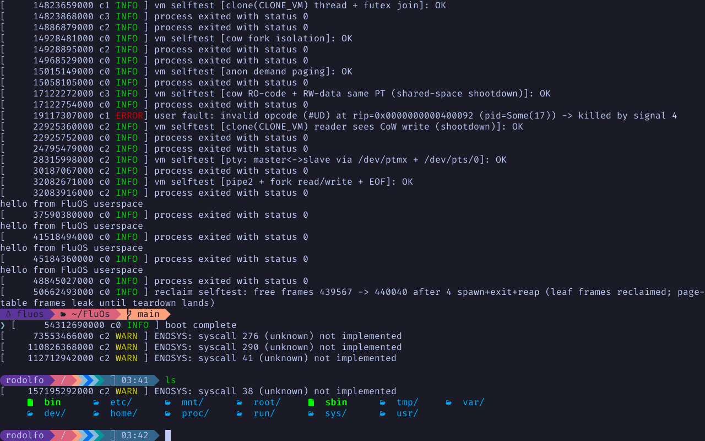

<p align="center">
  
</p>

<p align="center">
  <b>A from-scratch operating system with a Rust kernel.</b><br>
  It runs unmodified static Linux binaries through a Linux-compatible syscall ABI.
</p>

---

FluOS is a hobby OS built from zero: bootloader handoff, memory management, an SMP scheduler, a VFS, the syscall layer and a framebuffer console are all written in Rust for this project. The kernel implements the Linux x86_64 syscall ABI, so stock static (musl) binaries run on it unchanged.

The first goal is a fast terminal-only system that boots straight into a real zsh environment: oh-my-zsh, zinit plugins, the starship prompt and colorls. A graphical shell built with Flutter is planned for later.

<p align="center">
  
</p>

## What works today

- **Boot**: UEFI via [Limine](https://codeberg.org/Limine/Limine), on a higher-half kernel with its own page tables (W^X, NX, SMEP, SMAP).
- **Memory**:
  - buddy and slab allocators;
  - demand paging, copy-on-write `fork`, and ELF segments paged in from the file on first touch;
  - full reclamation of frames and page tables;
  - lazy TLB with acknowledged cross-CPU shootdowns.
- **SMP scheduling**: per-CPU EEVDF runqueues with work stealing, IRQ-safe locks, and `sched_setaffinity`.
- **Userspace** (~100 Linux syscalls):
  - processes and threads: `fork`, `execve`, `clone(CLONE_VM)`, `futex`;
  - signals with POSIX `sigsuspend`/`SA_RESTART` semantics;
  - IPC and I/O: pipes, PTYs, `eventfd`, real `poll`/`select`;
  - timers: `setitimer`/`alarm`.
- **Filesystems**: a VFS with tmpfs (populated from an initramfs), devfs and procfs.
- **Console**:
  - a framebuffer terminal with an embedded Nerd Font and a VT/xterm parser (truecolor, damage tracking);
  - PS/2 and serial input.
- **Hardening**: ring-3 faults kill only the offending process. Boot-time self-tests prove hostile programs are contained.
- **Observability**: symbolized backtraces, a `dmesg` ring buffer, per-CPU stats in `/proc/fluos/stats`, and a kernel-level `strace` (`strace=all|<comm>|exec` on the kernel command line).
- **Userland**:
  - zsh 5.9, starship, git, curl, fzf and uutils coreutils, built as static musl binaries;
  - [`colorls`](userland/colorls), our Rust reimplementation of the Ruby gem, with byte-for-byte identical output that is ~15–24x faster.

## Layout

| Path | What |
|---|---|
| `kernel/` | The `no_std` kernel |
| `crates/` | Kernel subsystems as host-testable `no_std` crates (`mm`, `sched`, `vfs`, `tty`, `abi`, `cpio`, `ksyms`) |
| `userland/colorls` | colorls in Rust |
| `ports/` | Reproducible static musl builds of the userland (Docker) |
| `rootfs/` | Root filesystem skeleton (`/etc`, the default user's dotfiles) |
| `xtask/` | Build orchestration: `cargo xtask <command>` |

## Building and running

Requirements on the host:
- a Rust nightly (pinned in `rust-toolchain.toml`);
- QEMU and OVMF, xorriso and e2fsprogs (`brew install qemu xorriso e2fsprogs`);
- Docker, for the userland ports;
- a Nerd Font for the console (FiraCode Nerd Font Mono by default; set `FLUOS_FONT` to use another).

```sh
cargo xtask rootfs   # build the static userland and the initramfs (first run takes a while)
cargo xtask run      # boot FluOS in QEMU (UEFI, 4 CPUs)
cargo xtask test     # headless boot with the kernel self-tests (--smp N)
cargo xtask e2e      # boot and drive the shell over serial, asserting on the output
cargo test -p mm -p sched -p vfs -p tty -p abi -p cpio -p ksyms   # host unit tests
```

## Roadmap

1. Persistent storage: PCI, virtio-blk, NVMe and AHCI drivers, plus an ext2 filesystem for `/home`.
2. Networking: virtio-net and Intel NIC drivers, a TCP/IP stack, `git clone` and `curl`.
3. USB keyboards (xHCI + HID), for real PCs without PS/2.
4. Login and the final shell environment.
5. Performance work and booting on real hardware.

Later: native containers able to run OCI images from Docker Hub, and a Flutter-based graphical shell. See [`docs/backlog.md`](docs/backlog.md).

## Mascot

<p align="center">
  
</p>

The FluOS axolotl. Axolotls regenerate, which is what we want from a kernel.

## License

Licensed under either of [Apache License, Version 2.0](LICENSE-APACHE) or [MIT license](LICENSE-MIT), at your option.

`userland/colorls` bundles data files from the [colorls](https://github.com/athityakumar/colorls) gem (MIT); see `userland/colorls/data/`.
